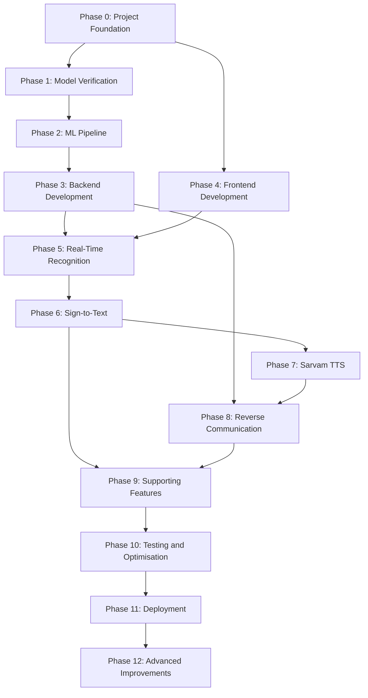

# Signova AI: Phase-Wise Development Roadmap

## 1. Overview

This document defines the complete development roadmap for Signova AI, an AI-powered Indian Sign Language (ISL) recognition and communication platform.

Development will follow a structured, phase-wise approach. Each phase will contain specific features, implementation tasks, dependencies, and expected outputs.

The project will prioritise a working ISL recognition baseline before expanding into advanced features such as dynamic sign recognition, sentence construction, speech integration, and continuous sign language understanding.

### Development Principles

- Build incrementally, not all features at once.
- Verify pretrained models before integrating them.
- Prioritise a working end-to-end prototype.
- Keep frontend, backend, and ML modules separate.
- Test every major feature.
- Avoid unnecessary dependencies and infrastructure.
- Document implementation decisions.
- Do not claim features are complete until they are tested.
- Maintain a clear distinction between implemented and planned features.

---

# 2. Phase Summary

| Phase | Name | Priority |
|---|---|---|
| Phase 0 | Project Foundation and Documentation | Critical |
| Phase 1 | ISL Model Research and Verification | Critical |
| Phase 2 | ML Inference Pipeline | Critical |
| Phase 3 | Backend Development | Critical |
| Phase 4 | Frontend Development | High |
| Phase 5 | Real-Time Camera Recognition | Critical |
| Phase 6 | Sign-to-Text and Sentence Construction | High |
| Phase 7 | Sarvam AI Speech Integration | High |
| Phase 8 | Reverse Communication | High |
| Phase 9 | Supporting Features and Accessibility | Medium |
| Phase 10 | Testing and Performance Optimisation | Critical |
| Phase 11 | Deployment and Final Demonstration | Critical |
| Phase 12 | Advanced ISL Recognition and Future Improvements | Future |

---

# 3. Phase 0: Project Foundation and Documentation

**Objective:** Establish the complete project structure, development rules, technical documentation, and environment.

### Features and Tasks

#### 0.1 GitHub Repository Setup

- Create the Signova AI repository.
- Configure the default branch.
- Create a `.gitignore`.
- Add a professional README.
- Add a project licence after deciding the project's licensing approach.
- Establish a consistent commit naming convention.

#### 0.2 Project Structure

Create the required folders:

```text
signova-ai/
├── .agents/
│   ├── rules/
│   ├── workflows/
│   └── skills/
│
├── .github/
│   └── workflows/
│
├── docs/
│
├── frontend/
│
├── backend/
│
├── ml/
│
├── database/
│
├── scripts/
│
├── tests/
│
├── .env.example
├── .gitignore
├── AGENTS.md
├── README.md
└── SECURITY.md
```

Add subfolders as implementation requires.

#### 0.3 Documentation Setup

Create and maintain:

- `docs/PRD.md`
- `docs/PROJECT_OVERVIEW.md`
- `docs/FEATURES.md`
- `docs/TECH_STACK.md`
- `docs/SYSTEM_ARCHITECTURE.md`
- `docs/AI_MODEL_STRATEGY.md`
- `docs/PHASE_ROADMAP.md`
- `docs/UI_UX_GUIDELINES.md`
- `docs/API_DOCUMENTATION.md`
- `docs/DATABASE_SCHEMA.md`
- `docs/TESTING_STRATEGY.md`
- `docs/SECURITY.md`
- `docs/DEPLOYMENT.md`
- `docs/PROGRESS_TRACKER.md`

#### 0.4 Development Environment

Frontend:
- Node.js.
- npm.
- React.
- Vite.
- Tailwind CSS.

Backend and ML:
- Python 3.11.
- FastAPI.
- PyTorch.
- OpenCV.
- Required ML dependencies.

#### 0.5 Antigravity Configuration

- Create root `AGENTS.md`.
- Configure frontend rules.
- Configure backend rules.
- Configure ML rules.
- Configure testing rules.
- Add reusable development workflows where useful.

### Expected Deliverables

- GitHub repository ready.
- Project folders created.
- All core documentation available.
- Frontend and backend environments configured.
- Antigravity project rules established.

### Completion Criteria

- Project can be cloned and opened.
- Frontend dependencies install successfully.
- Backend environment runs successfully.
- Documentation is consistent.
- No unnecessary or unused dependencies are added.

**Depends on:** None.

---

# 4. Phase 1: ISL Model Research and Verification

**Objective:** Find and verify a suitable pretrained Indian Sign Language recognition model.

This phase is critical because the quality of Signova AI depends heavily on the recognition model.

### Features and Tasks

#### 1.1 Model Research

Investigate suitable pretrained models for:

- Static ISL alphabet recognition.
- Static ISL gesture recognition.
- Dynamic ISL word recognition.
- Future continuous ISL recognition.

Candidate repositories must be inspected before selection.

#### 1.2 Repository Inspection

For every candidate:

- Inspect the source code.
- Identify the model architecture.
- Check the trained checkpoint.
- Identify supported sign classes.
- Inspect class labels.
- Check input image or video dimensions.
- Identify preprocessing requirements.
- Check Python and library dependencies.
- Review the licence.
- Review dataset sources and provenance.

#### 1.3 Checkpoint Verification

- Confirm checkpoint availability.
- Check file size.
- Confirm compatibility with the architecture.
- Verify loading instructions.
- Avoid downloading unnecessarily large model files.
- Record checkpoint location and version.

#### 1.4 Local Model Testing

- Create a clean Python environment.
- Install only required dependencies.
- Load the model.
- Test it using sample inputs.
- Confirm output format.
- Check prediction consistency.
- Measure basic inference time.

#### 1.5 Model Comparison

Compare candidate models using:

- Recognition task.
- Supported classes.
- Test accuracy.
- Macro F1-score.
- Per-class performance.
- Inference latency.
- Memory usage.
- Licence.
- Ease of integration.

Use measured results only.

### Expected Deliverables

- Model research report.
- Candidate model comparison.
- Verified model checkpoint.
- Model architecture documentation.
- Preprocessing documentation.
- Initial local inference test.

### Completion Criteria

- At least one suitable candidate has been tested.
- Its supported classes are known.
- Checkpoint loading works.
- Preprocessing is understood.
- Licence and data provenance have been reviewed.
- Actual test results are documented.

**Depends on:** Phase 0.

**Important:** Do not proceed with production integration until a candidate model has passed verification.

---

# 5. Phase 2: ML Inference Pipeline

**Objective:** Build a reusable machine learning pipeline that can process inputs and return ISL recognition predictions.

### Features and Tasks

#### 2.1 Model Loader

Implement:

- Model architecture loading.
- Checkpoint loading.
- Device selection.
- Model initialisation.
- Model configuration management.
- Error handling.

#### 2.2 Image Preprocessing

Implement model-specific preprocessing:

- Image loading.
- Image validation.
- Colour conversion where required.
- Image resizing.
- Normalisation.
- Tensor conversion.
- Batch preparation.

#### 2.3 Video Preprocessing

For dynamic recognition models:

- Video frame extraction.
- Frame sampling.
- Sequence preparation.
- Frame validation.
- Temporal ordering.
- Sequence normalisation.

Implement only when a suitable dynamic model is verified.

#### 2.4 Landmark Extraction

If required by the selected model:

- Integrate MediaPipe.
- Extract hand landmarks.
- Validate landmark coordinates.
- Handle missing hand detection.
- Prepare landmark sequences.

Do not add an unnecessary landmark extraction pipeline if the model accepts raw images or video directly.

#### 2.5 Prediction Engine

Implement:

- Model inference.
- Class probability calculation where supported.
- Predicted class selection.
- Confidence score generation.
- Prediction validation.
- Unknown-sign handling.

#### 2.6 Prediction Smoothing

Implement:

- Consecutive prediction validation.
- Sliding-window voting where suitable.
- Duplicate prediction suppression.
- Temporal smoothing for live recognition.

#### 2.7 Model Evaluation

Measure:

- Accuracy.
- Precision.
- Recall.
- F1-score.
- Macro F1-score.
- Confusion matrix.
- Inference latency.
- Memory usage.

Use a suitable test set, preferably including unseen signers.

### Expected Deliverables

- Working ML inference module.
- Model loader.
- Preprocessing pipeline.
- Prediction engine.
- Prediction validation.
- Evaluation scripts.
- Evaluation report.

### Completion Criteria

- Model loads correctly.
- Valid input produces a prediction.
- Invalid input is handled safely.
- Unknown predictions are supported.
- Evaluation results are reproducible.
- Inference performance is measured.

**Depends on:** Phase 1.

---

# 6. Phase 3: Backend Development

**Objective:** Build a FastAPI backend that exposes the ML recognition pipeline through structured APIs.

### Features and Tasks

#### 3.1 FastAPI Setup

- Initialise FastAPI.
- Configure application settings.
- Configure CORS.
- Add environment variable management.
- Add API versioning.
- Add central error handling.
- Add logging.

#### 3.2 API Structure

Create a modular structure:

```text
backend/
└── app/
    ├── api/
    │   └── v1/
    │       └── endpoints/
    │
    ├── core/
    │
    ├── models/
    │
    ├── schemas/
    │
    ├── services/
    │
    ├── websocket/
    │
    ├── database/
    │
    └── main.py
```

#### 3.3 Health API

Implement:

`GET /api/v1/ai/health`

Expected response:

- API status.
- Model loading status.
- Available recognition capabilities.

#### 3.4 Model Information API

Implement:

`GET /api/v1/ai/models`

Return:

- Approved model names.
- Model versions.
- Recognition tasks.
- Supported classes where appropriate.

#### 3.5 Image Prediction API

Implement:

`POST /api/v1/ai/predict/image`

Responsibilities:

- Receive image.
- Validate image format.
- Apply preprocessing.
- Execute inference.
- Return prediction and confidence.

#### 3.6 Video Prediction API

Implement:

`POST /api/v1/ai/predict/video`

Responsibilities:

- Receive supported video input.
- Validate video.
- Extract frames.
- Prepare sequence.
- Run dynamic model inference when available.
- Return recognised result.

#### 3.7 WebSocket Infrastructure

Prepare:

`/api/v1/ai/predict/stream`

Implement only when live camera recognition is ready.

Responsibilities:

- Accept client connection.
- Receive frame data.
- Validate incoming frames.
- Run inference.
- Return prediction messages.
- Handle disconnection and errors.

#### 3.8 API Documentation

- Add request schemas.
- Add response schemas.
- Document API errors.
- Test endpoints.
- Verify Swagger UI at `/docs`.

### Expected Deliverables

- Running FastAPI backend.
- Working health endpoint.
- Working model information endpoint.
- Working image prediction endpoint.
- Video endpoint if dynamic model is available.
- WebSocket endpoint when required.
- API documentation.

### Completion Criteria

- Backend starts without errors.
- Endpoints return valid responses.
- ML inference works through the API.
- Invalid requests return meaningful errors.
- API documentation is available.

**Depends on:** Phase 2.

---

# 7. Phase 4: Frontend Development

**Objective:** Build the Signova AI user interface and core application experience.

Frontend development can happen in parallel with Phase 2 and Phase 3 if API contracts and design requirements are agreed upon.

### Features and Tasks

#### 4.1 Frontend Setup

- Create React application using Vite.
- Configure Tailwind CSS.
- Configure shadcn/ui where required.
- Install React Router.
- Configure Lucide React icons.
- Establish reusable components.
- Configure API service layer.

#### 4.2 Landing Page

Build:

- Navigation bar.
- Hero section.
- Project introduction.
- How it works.
- Features section.
- Accessibility benefits.
- Call-to-action.
- Footer.

#### 4.3 Dashboard

Build:

- Welcome section.
- Recognition entry point.
- Available features.
- Recent activity placeholder.
- Quick navigation.

Do not display fabricated usage statistics or recognition history.

#### 4.4 Recognition Interface

Build:

- Camera preview container.
- Start camera button.
- Stop camera button.
- Recognition status.
- Prediction result.
- Confidence display.
- Clear result button.
- Loading and error states.

#### 4.5 Result Display

Build:

- Recognised sign label.
- Recognised text.
- Confidence information.
- Copy text button.
- Speech playback controls when available.

#### 4.6 Responsive Design

Support:

- Desktop.
- Laptop.
- Tablet.
- Mobile.

#### 4.7 Accessibility

Implement:

- Clear text contrast.
- Keyboard navigation.
- Descriptive button labels.
- Visible focus indicators.
- Screen-reader-friendly labels.
- Responsive text sizing.

### Expected Deliverables

- Working React application.
- Landing page.
- Dashboard.
- Recognition interface.
- Result components.
- Responsive layouts.
- Reusable UI components.

### Completion Criteria

- All main pages render correctly.
- Navigation works.
- Components are reusable.
- Responsive layouts work.
- Loading and error states are present.
- No fake AI predictions are displayed.

**Depends on:** Phase 0.

**Integration dependency:** API contracts from Phase 3.

---

# 8. Phase 5: Real-Time Camera Recognition

**Objective:** Connect the browser camera to the backend recognition pipeline.

This is one of the most important project milestones.

### Features and Tasks

#### 5.1 Camera Access

Implement:

- Browser camera permission.
- Camera initialisation.
- Camera preview.
- Camera selection where supported.
- Start and stop controls.
- Permission error handling.

#### 5.2 Frame Capture

Implement:

- Frame extraction from video.
- Frame resizing if required.
- Frame sampling.
- Frame transmission.
- Frame processing limits.

Do not send every camera frame without considering bandwidth and inference performance.

#### 5.3 Backend Connection

- Connect frontend to the prediction API.
- Implement WebSocket communication if required.
- Send frame data.
- Receive prediction results.
- Handle connection failures.
- Reconnect safely where appropriate.

#### 5.4 Live Prediction

Display:

- Recognised sign.
- Confidence score.
- Recognition status.
- Processing status.
- Unknown-sign status.

#### 5.5 Prediction Stability

Implement:

- Prediction smoothing.
- Repeated prediction suppression.
- Stable result display.
- Clear prediction action.

#### 5.6 Camera Controls

Implement:

- Start recognition.
- Pause recognition.
- Resume recognition.
- Stop recognition.
- Restart camera.

#### 5.7 Performance Monitoring

Measure:

- Frame processing time.
- Model inference latency.
- End-to-end response time.
- Dropped frames.
- WebSocket connection stability.

### Expected Deliverables

- Working browser camera.
- Camera preview.
- Frame capture pipeline.
- Backend connection.
- Live recognition prototype.
- Prediction status and error handling.

### Completion Criteria

- Camera permission works.
- Frames reach the backend.
- Predictions return to the frontend.
- Recognition results are displayed correctly.
- Pause and stop controls work.
- Performance is measured on the target hardware.

**Depends on:** Phase 2, Phase 3, and Phase 4.

---

# 9. Phase 6: Sign-to-Text and Sentence Construction

**Objective:** Convert recognised signs into usable text output.

The initial implementation should support only the recognition classes actually available in the verified model.

### Features and Tasks

#### 6.1 Label Mapping

- Map model class IDs to readable labels.
- Maintain a documented class mapping.
- Validate missing or unknown labels.

#### 6.2 Prediction Collection

- Collect accepted predictions.
- Ignore unstable predictions.
- Suppress repeated frames of the same sign.
- Add accepted results to the recognition sequence.

#### 6.3 Text Construction

For supported signs:

- Convert labels into text.
- Append recognised results.
- Allow users to edit text.
- Allow users to clear the text.
- Allow users to copy the text.

#### 6.4 Sequence Management

Implement:

- Prediction history for the current session.
- Duplicate suppression.
- Sequence ordering.
- Undo the last accepted prediction.
- Clear the current sequence.

#### 6.5 Sentence Construction

For future dynamic and vocabulary expansion:

- Investigate sign boundary detection.
- Investigate word sequence handling.
- Investigate ISL grammar.
- Investigate context-aware sentence construction.

Do not assume that alphabet labels can be directly combined into grammatically correct ISL sentences.

### Expected Deliverables

- Recognised label mapping.
- Sign-to-text conversion.
- Editable text area.
- Prediction sequence.
- Copy and clear functionality.
- Initial sentence construction where supported.

### Completion Criteria

- Only valid predictions are accepted.
- Duplicate predictions are handled.
- Text output matches recognised labels.
- Users can edit and copy results.
- Unsupported sequences are not presented as accurate translations.

**Depends on:** Phase 5.

---

# 10. Phase 7: Sarvam AI Speech Integration

**Objective:** Add spoken output for recognised text using Sarvam AI.

### Features and Tasks

#### 7.1 Sarvam API Setup

- Review available Sarvam APIs.
- Confirm supported models.
- Check supported languages.
- Configure backend API credentials.
- Add environment variables.
- Implement secure API access.

#### 7.2 Text-to-Speech

Implement:

- Send recognised text to the backend.
- Validate text input.
- Request speech generation.
- Receive audio output.
- Play generated audio.
- Handle API failures.

#### 7.3 Language Selection

Where supported:

- Display available languages.
- Allow users to choose a language.
- Store the current session preference.
- Use the selected language for speech output.

#### 7.4 Audio Controls

Implement:

- Play.
- Pause where supported.
- Replay.
- Stop.
- Loading state.
- Error state.

#### 7.5 Speech Output Integration

Connect the speech output to the recognised text interface.

### Expected Deliverables

- Sarvam API integration.
- Secure backend speech service.
- Text-to-speech feature.
- Language selection for supported languages.
- Audio playback controls.

### Completion Criteria

- Valid text generates audio.
- Audio plays correctly.
- Supported languages are clearly identified.
- API errors are handled.
- Credentials are not exposed in frontend code.

**Depends on:** Phase 6.

---

# 11. Phase 8: Reverse Communication

**Objective:** Allow non-signers to communicate with sign language users through speech and text.

This phase introduces voice input and language processing.

### Features and Tasks

#### 8.1 Microphone Access

- Request microphone permission.
- Start recording.
- Stop recording.
- Validate audio input.
- Handle permission errors.

#### 8.2 Speech-to-Text

- Send audio to the backend.
- Integrate supported Sarvam STT functionality.
- Receive transcription.
- Display recognised text.
- Handle transcription failures.

#### 8.3 Translation

Where required:

- Identify source language.
- Select target language.
- Use supported Sarvam translation functionality.
- Display translated text.
- Allow users to edit the output.

#### 8.4 Conversation Interface

Build:

- Sign recognition message area.
- Voice transcription message area.
- Translation output.
- Clear conversation.
- Copy message.
- Session status.

#### 8.5 Conversation Flow

Support the following interaction:

```text
Sign Language User
        |
        v
Camera Recognition
        |
        v
Recognised Text
        |
        v
Speech Output
        |
        v
Non-Signer
        |
        v
Voice Input
        |
        v
Speech-to-Text
        |
        v
Translated Text
        |
        v
Sign Language User
```

This is a text and speech communication flow. It does not yet generate sign language animation or automatically translate spoken language into a complete ISL visual sequence.

### Expected Deliverables

- Microphone input.
- Speech-to-text integration.
- Supported language translation.
- Conversation interface.
- Text output and playback.

### Completion Criteria

- Microphone permission works.
- Audio reaches the backend.
- Transcription is displayed.
- Translation works for supported languages.
- Errors are handled.
- Conversation output is understandable and editable.

**Depends on:** Phase 3, Phase 4, and Phase 7.

---

# 12. Phase 9: Supporting Features and Accessibility

**Objective:** Improve usability and provide supporting application features.

These features should be added after the core recognition and communication workflow is working.

### Features and Tasks

#### 9.1 User Preferences

- Theme preference.
- Preferred speech language.
- Camera preferences.
- Accessibility settings.

#### 9.2 User Authentication

Only if required:

- Registration.
- Login.
- Logout.
- Session management.
- Protected routes.

#### 9.3 PostgreSQL Database

Add persistent storage only where required.

Potential data:

- User profiles.
- User preferences.
- Conversation history, if users opt in.
- Application settings.

Avoid storing raw camera video by default.

#### 9.4 History

Where enabled:

- Store recognised text.
- Display previous sessions.
- Delete history.
- Clear all stored history.
- Apply appropriate access controls.

#### 9.5 Learning Centre

Potential features:

- ISL learning resources.
- Supported sign vocabulary.
- Sign demonstrations.
- Basic educational content.
- Links to trusted learning resources.

Content should be reviewed for ISL accuracy.

#### 9.6 Practice and Quiz Module

Potential features:

- Display a supported sign.
- Ask users to identify it.
- Check model predictions.
- Display correct answers.
- Show learning progress.

#### 9.7 Accessibility Improvements

- High contrast mode.
- Larger text.
- Keyboard accessibility.
- Clear visual status indicators.
- Accessible form controls.
- Reduced-motion preference.

### Expected Deliverables

- User preferences.
- Optional authentication.
- Optional database persistence.
- History interface.
- Learning centre.
- Accessibility settings.

### Completion Criteria

- Supporting features work independently.
- Stored information is protected.
- Users can control their stored data.
- Accessibility settings are usable.
- Core recognition performance is unaffected.

**Depends on:** Relevant features from Phases 4, 6, 7, and 8.

---

# 13. Phase 10: Testing and Performance Optimisation

**Objective:** Verify that Signova AI works reliably and meets its documented requirements.

### Features and Tasks

#### 10.1 ML Testing

- Test model loading.
- Test preprocessing.
- Test valid predictions.
- Test invalid inputs.
- Test unknown-sign handling.
- Test prediction consistency.
- Evaluate unseen samples.
- Evaluate different signers.

#### 10.2 Backend Testing

- Test API endpoints.
- Test request validation.
- Test response schemas.
- Test model integration.
- Test WebSocket communication.
- Test error handling.
- Test authentication if implemented.

Use Pytest and FastAPI TestClient or HTTPX.

#### 10.3 Frontend Testing

- Test page rendering.
- Test navigation.
- Test camera permissions.
- Test recognition states.
- Test API communication.
- Test audio playback.
- Test error states.

Use Vitest and React Testing Library.

#### 10.4 End-to-End Testing

Test the complete workflow:

```text
Open Application
       |
       v
Grant Camera Permission
       |
       v
Start Recognition
       |
       v
Capture Camera Input
       |
       v
Backend Inference
       |
       v
Display Prediction
       |
       v
Convert Text to Speech
       |
       v
Play Audio
```

Test reverse communication separately.

#### 10.5 Performance Optimisation

Measure and improve:

- Model inference latency.
- End-to-end response time.
- Frame processing speed.
- Frontend responsiveness.
- Memory usage.
- API response time.
- WebSocket stability.

#### 10.6 Security Testing

- Validate file uploads.
- Protect API credentials.
- Check CORS configuration.
- Verify input validation.
- Check authentication where implemented.
- Review personal data handling.
- Check dependency vulnerabilities.

### Expected Deliverables

- Unit tests.
- Integration tests.
- End-to-end test results.
- Model evaluation report.
- Performance report.
- Security review.
- Bug tracking list.

### Completion Criteria

- Critical workflows pass.
- No unresolved critical bugs.
- Model metrics are documented.
- Performance limitations are known.
- Security issues are addressed.

**Depends on:** All implemented feature phases.

---

# 14. Phase 11: Deployment and Final Demonstration

**Objective:** Deploy the application and prepare a reliable demonstration.

### Features and Tasks

#### 11.1 Frontend Deployment

Potential platform:

- Vercel.

Tasks:

- Configure build command.
- Configure environment variables.
- Set backend API URL.
- Test production build.
- Verify camera access over HTTPS.
- Test mobile and desktop layouts.

#### 11.2 Backend Deployment

Potential platforms:

- Render.
- Other compatible Python hosting services.

Tasks:

- Configure Python environment.
- Install dependencies.
- Configure environment variables.
- Configure model checkpoint storage.
- Test health endpoint.
- Verify inference.
- Verify timeouts and resource limits.
- Verify WebSocket support if required.

Confirm hosting limits and costs before deployment.

#### 11.3 Production Configuration

- Separate development and production settings.
- Configure allowed frontend origins.
- Secure API keys.
- Add appropriate logging.
- Disable debug mode.
- Validate upload limits.
- Add basic monitoring.

#### 11.4 Final Demonstration

Prepare a demonstration showing:

1. Signova AI introduction.
2. Problem statement.
3. Camera access.
4. Supported ISL recognition.
5. Recognised text.
6. Speech output.
7. Reverse voice communication.
8. Technical architecture.
9. Actual model evaluation results.
10. Future development plans.

Demonstrate only features that are working reliably.

#### 11.5 Project Documentation

Update:

- README.
- Installation instructions.
- Environment setup.
- API documentation.
- Architecture.
- Model details.
- Evaluation results.
- Screenshots.
- Demo instructions.
- Known limitations.

### Expected Deliverables

- Deployed frontend.
- Deployed backend.
- Production environment.
- Final demonstration.
- Updated GitHub repository.
- Project documentation.

### Completion Criteria

- Frontend is accessible.
- Backend health check works.
- Core recognition workflow works in production.
- Environment variables are configured securely.
- Demo is tested before presentation.
- Known limitations are documented.

**Depends on:** Phase 10.

---

# 15. Phase 12: Advanced ISL Recognition and Future Improvements

**Objective:** Expand Signova AI beyond its initial supported vocabulary and improve its ability to understand natural ISL communication.

This phase is an advanced research and development stage.

### Features and Tasks

#### 12.1 Expanded Vocabulary

- Increase supported ISL signs.
- Collect or obtain suitable licensed data.
- Include diverse signers.
- Improve class balance.
- Evaluate generalisation.

#### 12.2 Dynamic Sign Recognition

- Evaluate temporal models.
- Test video sequence recognition.
- Improve sign boundary detection.
- Improve prediction stability.
- Evaluate unseen signers.

#### 12.3 Continuous ISL Understanding

Research:

- Continuous sign recognition.
- Sign segmentation.
- Temporal sequence modelling.
- Context-aware interpretation.
- ISL grammar.
- Non-manual features.

#### 12.4 Advanced Sentence Construction

- Investigate ISL-specific sentence structure.
- Reduce ambiguity.
- Improve context handling.
- Preserve meaning.
- Evaluate sentence quality with appropriate human review.

#### 12.5 Sign Generation Research

Investigate possible future approaches for converting text or speech into understandable ISL representations.

This may require:

- Verified ISL vocabulary.
- Sign animation or video assets.
- Linguistic review.
- Appropriate avatar or animation technology.

Sarvam speech APIs alone do not provide sign generation.

#### 12.6 Mobile Application

Potential future development:

- React Native or another suitable mobile framework.
- Mobile camera support.
- On-device inference where feasible.
- Offline functionality where feasible.
- Performance optimisation.

### Expected Deliverables

- Expanded ISL vocabulary.
- Improved dynamic recognition.
- Continuous recognition research prototype.
- Advanced sentence construction prototype.
- Sign generation feasibility study.
- Mobile application prototype, if prioritised.

### Completion Criteria

- Each advanced capability has a defined dataset and evaluation method.
- Recognition quality is measured.
- Linguistic accuracy is reviewed.
- Limitations are documented.
- No unsupported translation claims are made.

**Depends on:** Stable implementation of the relevant earlier phases.

---

# 16. Phase Dependencies

The following diagram shows the main implementation dependencies.



### Parallel Development Opportunities

Some tasks can be developed in parallel:

| Workstream A | Workstream B | Condition |
|---|---|---|
| Model research | Frontend UI design | No model dependency for static UI |
| ML pipeline | Backend foundation | API contract agreed |
| Frontend pages | Backend API implementation | Mock API contract documented |
| Documentation | Feature development | Docs remain updated |
| Accessibility testing | UI development | Testable screens available |

Do not integrate unfinished components without agreeing on their input and output formats.

---

# 17. Priority Classification

### Critical

These are required for a working core prototype:

- Project foundation.
- Verified ISL model.
- ML inference pipeline.
- FastAPI backend.
- Frontend recognition interface.
- Camera integration.
- Sign-to-text for supported classes.
- Testing.

### High

These significantly improve the communication experience:

- Sarvam text-to-speech.
- Reverse speech communication.
- Prediction stability.
- Accessibility improvements.
- Deployment.

### Medium

These improve product completeness:

- Authentication.
- Conversation history.
- User preferences.
- Learning centre.
- Practice quizzes.

### Future

These require additional research and validation:

- Expanded ISL vocabulary.
- Continuous ISL recognition.
- Advanced sentence construction.
- Sign generation.
- Mobile application.
- Offline recognition.

---

# 18. Project Progress Tracking

Maintain `docs/PROGRESS_TRACKER.md` throughout development.

Use the following status values:

| Status | Meaning |
|---|---|
| Not Started | Work has not started |
| In Progress | Currently being implemented |
| Testing | Implementation is complete and under testing |
| Blocked | Waiting for a dependency or decision |
| Completed | Implemented and verified |

### Progress Tracker Template

| Phase | Task | Status | Owner | Notes |
|---|---|---|---|---|
| 0 | Repository setup | Not Started | Team | |
| 0 | Documentation setup | Not Started | Team | |
| 1 | Model research | Not Started | Team | |
| 1 | Model verification | Not Started | Team | |
| 2 | ML inference pipeline | Not Started | Team | |
| 3 | FastAPI backend | Not Started | Team | |
| 4 | React frontend | Not Started | Team | |
| 5 | Camera integration | Not Started | Team | |
| 6 | Sign-to-text | Not Started | Team | |
| 7 | Sarvam TTS | Not Started | Team | |
| 8 | Reverse communication | Not Started | Team | |
| 9 | Supporting features | Not Started | Team | |
| 10 | Testing | Not Started | Team | |
| 11 | Deployment | Not Started | Team | |
| 12 | Advanced recognition | Not Started | Team | |

Update the tracker after every meaningful implementation task.

---

# 19. Definition of Done

A feature is considered complete only when:

1. Its requirements are understood.
2. Implementation is complete.
3. Code follows the project architecture.
4. Relevant tests have been written.
5. Tests have been executed.
6. Errors are handled.
7. The feature has been manually verified where appropriate.
8. Documentation is updated.
9. No fake data or results are presented as real.
10. Known limitations are recorded.

A feature that only has a UI design or placeholder response is not considered complete.

---

# 20. Instructions for Antigravity

Before starting any phase:

1. Read `AGENTS.md`.
2. Read `docs/PRD.md`.
3. Read `docs/PROJECT_OVERVIEW.md`.
4. Read `docs/FEATURES.md`.
5. Read `docs/TECH_STACK.md`.
6. Read `docs/SYSTEM_ARCHITECTURE.md`.
7. Read `docs/AI_MODEL_STRATEGY.md`.
8. Read this `docs/PHASE_ROADMAP.md`.
9. Inspect the existing project files and current implementation.
10. Identify dependencies and blockers before coding.

### Development Rules

- Work only on the requested phase and feature.
- Do not implement all phases in one task.
- Do not rewrite existing working code unnecessarily.
- Follow the approved technology stack.
- Use JavaScript, not TypeScript, for the frontend.
- Use Python 3.11 for backend and ML.
- Do not add unnecessary libraries.
- Do not create fake AI inference.
- Do not invent model evaluation results.
- Do not use ASL as the primary ISL model.
- Write tests for new functionality.
- Update relevant documentation.
- Keep secrets out of source control.
- Maintain compatibility with existing modules.

### After Each Task

Provide a completion report containing:

- Phase and feature completed.
- Files created.
- Files modified.
- Dependencies added.
- Implementation details.
- Tests executed.
- Actual test results.
- Known limitations.
- Remaining tasks.
- Recommended next task.

Do not mark a phase as complete until its completion criteria have been met.

---

# 21. Immediate Development Order

The first implementation cycle should follow this sequence:

| Order | Task | Expected Result |
|---|---|---|
| 1 | Complete project foundation | Clean project setup |
| 2 | Inspect ISL model candidates | Model comparison report |
| 3 | Verify one pretrained model | Successful local inference |
| 4 | Build ML inference pipeline | Reusable prediction module |
| 5 | Create FastAPI backend | Working prediction endpoint |
| 6 | Build React interface | Functional recognition UI |
| 7 | Connect browser camera | Camera input available |
| 8 | Connect live inference | Predictions displayed |
| 9 | Add sign-to-text | Recognised text output |
| 10 | Integrate Sarvam TTS | Spoken output |

Do not start by building every advanced feature. Establish a working and tested recognition workflow first.

---

# 22. Final Project Milestones

| Milestone | Expected Outcome |
|---|---|
| M1: Foundation Ready | Repository, documentation, and environment |
| M2: Model Verified | Suitable ISL model runs locally |
| M3: AI Pipeline Ready | Reusable inference and evaluation |
| M4: Backend Ready | Prediction APIs work |
| M5: Frontend Ready | Recognition interface works |
| M6: Live Recognition Ready | Camera-to-prediction workflow works |
| M7: Communication Ready | Sign-to-text and speech output work |
| M8: Reverse Communication Ready | Speech input and transcription work |
| M9: Quality Ready | Testing and performance evaluation complete |
| M10: Demo Ready | Deployed and verified demonstration |

---

## 23. Final Development Strategy

Signova AI will be developed in three major stages.

**Stage 1: Core Recognition**
- Verify a suitable ISL model.
- Build the inference pipeline.
- Develop the backend.
- Connect the frontend camera.
- Display supported sign predictions.

**Stage 2: Accessible Communication**
- Convert recognised signs into text.
- Add Sarvam text-to-speech.
- Add reverse speech-to-text communication.
- Improve accessibility and usability.

**Stage 3: Advanced Intelligence**
- Expand the ISL vocabulary.
- Add dynamic sign recognition.
- Research continuous sign language understanding.
- Improve context and sentence construction.
- Explore mobile and offline deployment.

**Final Goal:** Build a reliable, accessible, and extensible ISL communication platform that demonstrates real AI capabilities, reports its limitations honestly, and progressively improves communication between sign language users and non-signers.