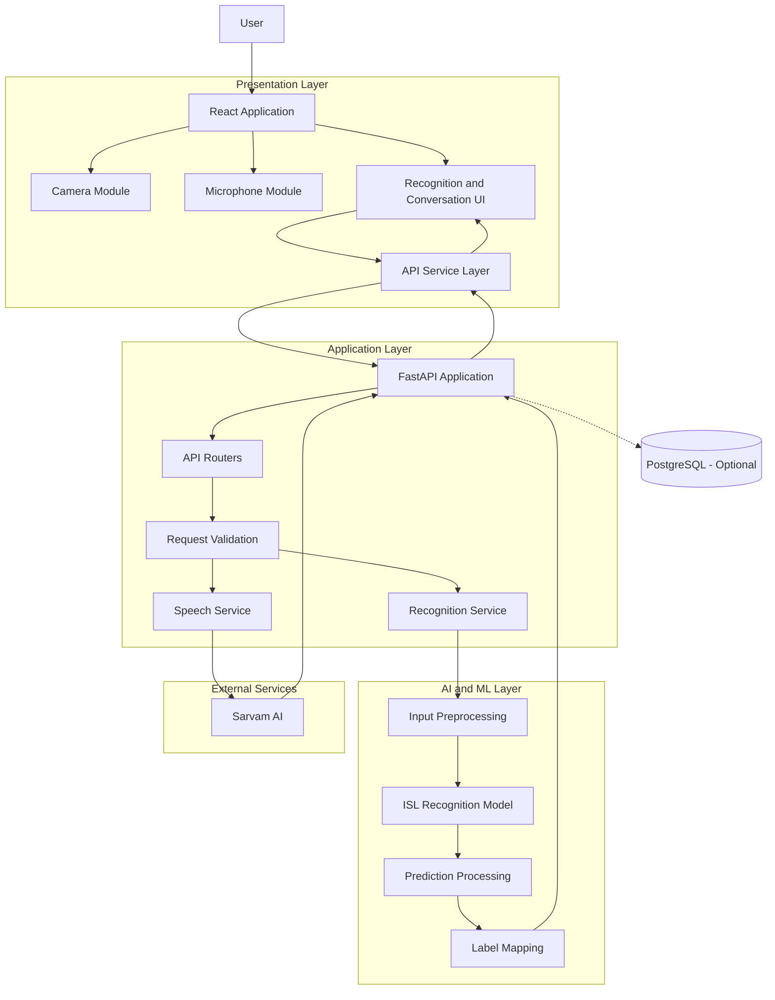
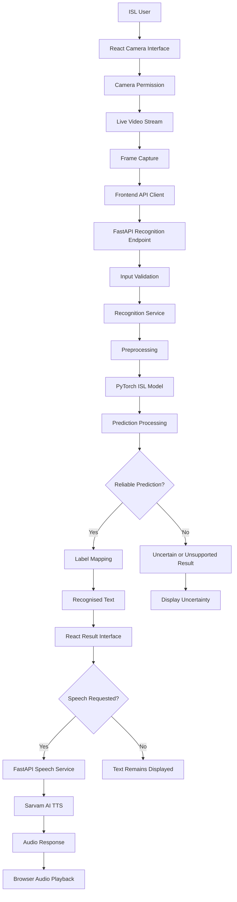
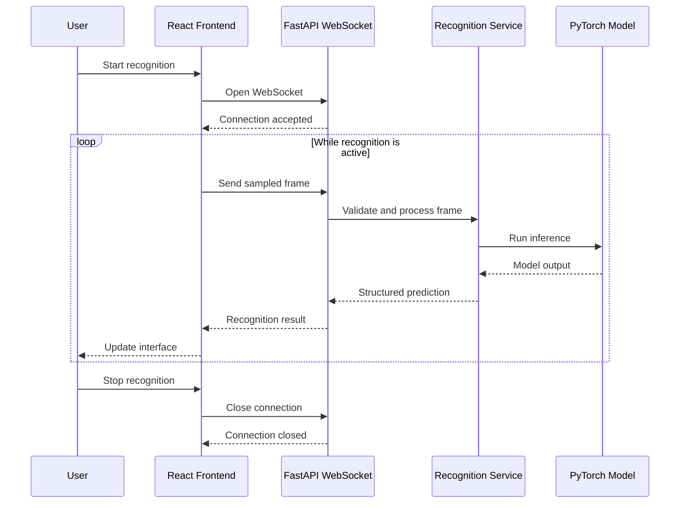
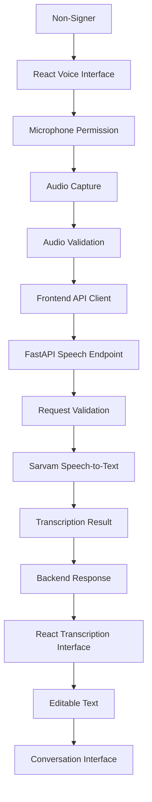
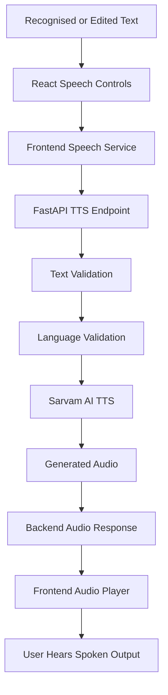
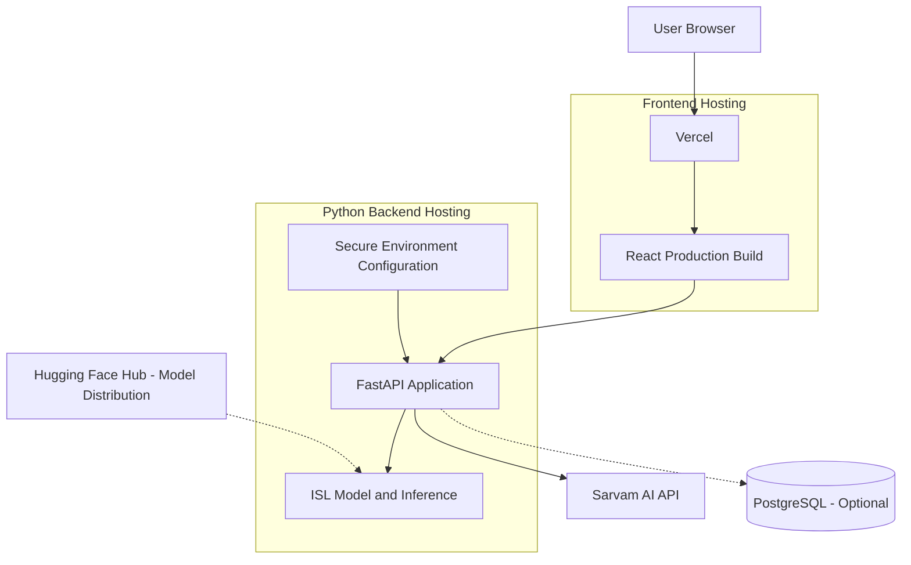

# Signova AI
# System Architecture and Technical Design

**Document:** SYSTEM_ARCHITECTURE.md  
**Version:** 1.0  
**Project:** Signova AI  
**Status:** Planning and Development  
**Architecture Style:** Modular Client-Server Architecture  
**Primary Platform:** Web Application  
**Primary Sign Language:** Indian Sign Language (ISL)

---

# 1. Purpose of This Document

This document defines the technical architecture of Signova AI.

It explains how the different parts of the application are organised, how they communicate, and how data moves through the system.

It serves as the main architecture reference for developers and AI coding agents.

The document defines:

- High-level system architecture.
- Frontend architecture.
- Backend architecture.
- Machine learning architecture.
- Speech service architecture.
- API communication.
- Real-time recognition workflow.
- Data flow.
- Module responsibilities.
- Error handling.
- Security and privacy boundaries.
- Deployment architecture.
- Testing and scalability considerations.

Antigravity must follow this architecture when implementing project features.

## Related Documents

| Document | Responsibility |
|---|---|
| `PRD.md` | Product requirements |
| `PROJECT_OVERVIEW.md` | Product vision and workflows |
| `FEATURES.md` | Feature specifications |
| `TECH_STACK.md` | Approved technology stack |
| `SYSTEM_ARCHITECTURE.md` | System design and component interactions |
| `AI_MODEL_STRATEGY.md` | ML model and dataset decisions |
| `PHASE_ROADMAP.md` | Development phases |
| `API_DOCUMENTATION.md` | API contracts |
| `DATABASE_SCHEMA.md` | Database structure |
| `SECURITY.md` | Security and privacy requirements |

---

# 2. Architecture Overview

## 2.1 Architecture Summary

Signova AI uses a modular client-server architecture.

The system is divided into four main technical layers:

1. Presentation Layer: React frontend.
2. Application Layer: Python and FastAPI backend.
3. Intelligence Layer: ISL recognition and prediction processing.
4. External Services Layer: Sarvam AI speech and language services.

PostgreSQL may be introduced as a separate persistence layer when user accounts, preferences, or conversation history require permanent storage.

The initial MVP should remain simple. It does not require microservices, Kubernetes, or unnecessary infrastructure.

## 2.2 High-Level Architecture Diagram



This diagram represents logical responsibilities. It does not require each box to run as a separate deployed service.

## 2.3 Architecture Principles

The architecture must follow these principles:

- Separation of responsibilities.
- Modular implementation.
- Reusable services.
- Clear API contracts.
- Independent ML inference.
- Secure external service integration.
- Minimal data collection.
- Testable components.
- Replaceable recognition models.
- Incremental development.

---

# 3. System Components

## 3.1 Component Overview

| Component | Technology | Responsibility |
|---|---|---|
| Web Application | React + JavaScript | Main user interface |
| Camera Controller | Browser MediaDevices API | Access camera |
| Microphone Controller | Browser MediaDevices API | Capture speech |
| Frontend API Client | Fetch API or Axios | Backend communication |
| API Server | FastAPI | Handle application requests |
| Request Validation | Pydantic | Validate incoming data |
| Recognition Service | Python | Coordinate ML inference |
| Preprocessing Module | OpenCV, NumPy | Prepare visual inputs |
| Recognition Model | PyTorch | Predict supported ISL signs |
| Prediction Processor | Python | Handle confidence and stability |
| Label Mapper | Python | Convert class IDs to display labels |
| Speech Service | Python | Coordinate speech API requests |
| Speech Provider | Sarvam AI | STT, TTS, supported translation |
| Database | PostgreSQL, optional | Persistent application data |

## 3.2 Component Responsibilities

### Frontend

Responsible for:

- Displaying the application.
- Managing navigation.
- Requesting camera and microphone permission.
- Capturing media.
- Displaying recognition results.
- Displaying speech transcriptions.
- Playing generated audio.
- Managing temporary conversation state.
- Showing loading and error states.

The frontend must not contain ML model inference code or secret API credentials.

### Backend

Responsible for:

- Exposing REST endpoints.
- Managing WebSocket connections.
- Validating requests.
- Coordinating recognition services.
- Managing model lifecycle.
- Calling Sarvam AI.
- Handling errors.
- Returning structured responses.

### ML Layer

Responsible for:

- Loading the verified ISL model.
- Preprocessing visual input.
- Running inference.
- Processing prediction outputs.
- Returning supported class labels and relevant metadata.
- Supporting evaluation.

### External Speech Services

Responsible for supported speech and language operations:

- Speech-to-text.
- Text-to-speech.
- Translation where required.

Sarvam AI does not replace the visual ISL recognition model.

### Database

Responsible for future persistent data such as:

- User preferences.
- User profiles.
- Learning progress.
- Conversation metadata.

Persistent storage is optional in the initial MVP.

---

# 4. Frontend Architecture

## 4.1 Frontend Structure

The frontend uses React, JavaScript, Vite, Tailwind CSS, and shadcn/ui where appropriate.

Proposed structure:

```text
frontend/
├── public/
│
└── src/
    ├── assets/
    │
    ├── components/
    │   ├── common/
    │   ├── layout/
    │   ├── navigation/
    │   └── ui/
    │
    ├── pages/
    │   ├── Home.jsx
    │   ├── Dashboard.jsx
    │   ├── Recognition.jsx
    │   ├── VoiceCommunication.jsx
    │   ├── Conversation.jsx
    │   ├── Learning.jsx
    │   └── Settings.jsx
    │
    ├── features/
    │   ├── camera/
    │   ├── recognition/
    │   ├── speech/
    │   ├── conversation/
    │   └── learning/
    │
    ├── hooks/
    │   ├── useCamera.js
    │   ├── useMicrophone.js
    │   └── useRecognition.js
    │
    ├── context/
    │
    ├── services/
    │   ├── apiClient.js
    │   ├── recognitionService.js
    │   └── speechService.js
    │
    ├── utils/
    │
    ├── constants/
    │
    ├── styles/
    │
    ├── App.jsx
    └── main.jsx
```

This is a target structure. Create modules as features are implemented.

## 4.2 Page Responsibilities

| Page | Responsibility |
|---|---|
| Home | Introduce Signova AI |
| Dashboard | Main application navigation |
| Recognition | Camera-based ISL recognition |
| VoiceCommunication | Speech-to-text interaction |
| Conversation | Display both communication directions |
| Learning | Show verified ISL learning content |
| Settings | Application and accessibility preferences |

## 4.3 Feature-Based Organisation

Related functionality should be grouped together.

For example:

```text
features/
└── recognition/
    ├── components/
    │   ├── CameraPreview.jsx
    │   ├── RecognitionResult.jsx
    │   └── RecognitionControls.jsx
    │
    ├── hooks/
    │   └── useRecognition.js
    │
    ├── services/
    │   └── recognitionService.js
    │
    └── utils/
```

The exact files should depend on the implementation.

Avoid placing every component inside one large `components` directory.

## 4.4 Frontend State Management

Use React state and context for the initial MVP.

Suggested state ownership:

| State | Responsibility |
|---|---|
| Camera state | Camera active, paused, or stopped |
| Recognition state | Idle, processing, recognised, uncertain, or error |
| Latest prediction | Most recent validated result |
| Text output | Current editable text |
| Microphone state | Recording or stopped |
| Transcription | Latest speech-to-text result |
| Audio state | Playing, paused, stopped, or failed |
| Conversation state | Current session messages |

Avoid introducing Redux or another state management library unless application complexity requires it.

## 4.5 Camera Module

The camera module should:

1. Request permission.
2. Access a supported camera device.
3. Display the live stream.
4. Capture frames when recognition is active.
5. Stop capturing when paused.
6. Release camera resources when closed.

The camera module must not perform model inference.

It only manages media input.

## 4.6 Microphone Module

The microphone module should:

1. Request microphone permission.
2. Start audio capture after user action.
3. Stop audio capture.
4. Produce audio data in a supported format.
5. Submit audio through the API service.
6. Release microphone resources.

The microphone module must not call Sarvam AI directly.

All external API calls must go through the backend.

## 4.7 Frontend API Service Layer

All backend requests should be organised inside the service layer.

Example responsibilities:

`apiClient.js`
- Base URL configuration.
- Common request handling.
- Error handling.
- Request timeout configuration.

`recognitionService.js`
- Image prediction.
- Recognition status.
- WebSocket connection management where appropriate.

`speechService.js`
- Speech-to-text requests.
- Text-to-speech requests.
- Supported translation requests.

UI components must not contain repeated API configuration or secret credentials.

---

# 5. Backend Architecture

## 5.1 Backend Structure

Use FastAPI with a modular structure.

```text
backend/
│
├── app/
│   ├── api/
│   │   └── v1/
│   │       ├── endpoints/
│   │       │   ├── health.py
│   │       │   ├── model.py
│   │       │   ├── recognition.py
│   │       │   └── speech.py
│   │       │
│   │       └── router.py
│   │
│   ├── core/
│   │   ├── config.py
│   │   ├── exceptions.py
│   │   └── logging.py
│   │
│   ├── schemas/
│   │   ├── recognition.py
│   │   ├── speech.py
│   │   └── common.py
│   │
│   ├── services/
│   │   ├── recognition_service.py
│   │   ├── model_service.py
│   │   ├── speech_service.py
│   │   └── sarvam_service.py
│   │
│   ├── websocket/
│   │   └── recognition.py
│   │
│   ├── database/
│   │
│   └── main.py
│
├── tests/
├── requirements.txt
└── .env.example
```

## 5.2 API Layer

The API layer receives requests and returns responses.

Responsibilities:

- Route requests.
- Validate incoming data.
- Call the correct service.
- Return structured responses.
- Apply suitable error handling.

API routes must not contain large ML preprocessing or model inference implementations.

## 5.3 Service Layer

The service layer contains application logic.

Examples:

- Recognition service coordinates visual inference.
- Model service manages model loading and status.
- Speech service coordinates speech operations.
- Sarvam service communicates with external APIs.

This separation allows services to be tested independently.

## 5.4 Core Configuration

The core module manages:

- Environment variables.
- Application configuration.
- Service settings.
- Logging configuration.
- Shared exceptions.

Never hardcode API keys or deployment-specific secrets.

## 5.5 Application Startup

At application startup:

1. Load configuration.
2. Configure logging.
3. Initialise required services.
4. Load the recognition model if required.
5. Register API routes.
6. Start the application.

Model loading should happen once per application worker where practical, not once per prediction request.

If the model cannot load, the backend should expose an unavailable model status instead of pretending recognition is operational.

---

# 6. Machine Learning Architecture

## 6.1 ML Structure

```text
ml/
│
├── configs/
│   └── model_config.yaml
│
├── datasets/
│
├── preprocessing/
│   ├── image_preprocessing.py
│   └── frame_preprocessing.py
│
├── models/
│   ├── model_loader.py
│   └── model_registry.py
│
├── inference/
│   ├── predictor.py
│   └── inference_pipeline.py
│
├── training/
│
├── evaluation/
│   ├── evaluate.py
│   └── metrics.py
│
├── notebooks/
│
└── checkpoints/
```

Create files only when their corresponding functionality is required.

## 6.2 Model Loading

The model loader is responsible for:

- Reading model configuration.
- Loading the correct architecture.
- Loading the checkpoint.
- Selecting a compatible device.
- Setting inference mode.
- Reporting loading errors.

The model should be reusable throughout the application lifecycle.

## 6.3 Input Preprocessing

Preprocessing must match the selected model.

Potential operations:

- Image decoding.
- Frame selection.
- Resizing.
- Colour conversion.
- Normalisation.
- Tensor conversion.
- Landmark extraction when required.

Important:

Do not assume that every model uses the same input dimensions or preprocessing.

The original model's implementation and documentation must be inspected first.

## 6.4 Recognition Inference

The inference pipeline performs:

1. Input validation.
2. Preprocessing.
3. Model execution.
4. Output interpretation.
5. Prediction formatting.

The output must contain only information supported by the actual model.

## 6.5 Prediction Processing

Prediction processing may include:

- Confidence handling.
- Thresholding.
- Temporal smoothing.
- Duplicate suppression.
- Unknown-sign handling.
- Label mapping.

These operations must be configurable and independently testable.

## 6.6 Static and Dynamic Recognition

### Static Recognition

Uses image input to recognise supported static signs.

### Dynamic Recognition

Uses an ordered sequence of frames and a suitable temporal model.

### Continuous ISL Interpretation

Requires more advanced language and visual understanding.

These capabilities must remain separate in the architecture.

A static image classifier cannot be used as a substitute for a temporal recognition model.

## 6.7 MediaPipe Integration

MediaPipe may be used for landmark extraction if required by the selected model.

Possible outputs include:

- Hand landmarks.
- Body pose landmarks.
- Other supported visual landmarks.

MediaPipe must not be inserted into the pipeline automatically.

Its use must be justified by the selected model architecture and validated preprocessing.

---

# 7. Primary Workflow A: Sign-to-Text and Speech

This is the main Signova AI communication workflow.

## 7.1 Workflow Diagram



## 7.2 Detailed Data Flow

### Step 1: Camera Input

The user opens the recognition page and grants camera permission.

The frontend displays a live camera preview.

### Step 2: Frame Capture

The camera module captures frames at a controlled frequency.

The capture frequency must be selected based on:

- Model requirements.
- Network latency.
- Backend processing speed.
- Available hardware.

Do not transmit every video frame by default.

### Step 3: Backend Request

The frontend sends the frame to the recognition API.

The request format must match the selected API contract.

### Step 4: Input Validation

The backend validates:

- File format.
- File size.
- Image dimensions.
- Request structure.

Invalid inputs are rejected with meaningful errors.

### Step 5: Preprocessing

The ML pipeline prepares the image for the selected model.

### Step 6: Model Inference

The PyTorch model predicts a supported class.

### Step 7: Prediction Processing

The prediction processor handles:

- Confidence.
- Uncertainty.
- Smoothing where applicable.
- Duplicate predictions.
- Unknown-sign conditions.

### Step 8: Label Mapping

The predicted class ID is converted into a display label.

### Step 9: Frontend Display

The backend returns a structured result.

The frontend displays the recognised or uncertain state.

### Step 10: Speech Output

When the user requests speech, the text is sent to the backend speech service.

Sarvam AI generates audio for a supported language.

The frontend receives and plays the result.

---

# 8. Real-Time Recognition Architecture

## 8.1 Initial Implementation Strategy

Build recognition in two stages.

**Stage 1: Request-Response Recognition**

- Capture one frame.
- Send it to FastAPI.
- Process the image.
- Return one prediction.
- Display the result.

This stage verifies the complete ML integration without introducing streaming complexity.

**Stage 2: Continuous Recognition**

- Establish a WebSocket connection.
- Send frames at a controlled frequency.
- Process frames on the backend.
- Return recognition updates.
- Display results continuously.

Do not implement Stage 2 until Stage 1 works reliably.

## 8.2 WebSocket Architecture



## 8.3 Streaming Rules

- Use a documented frame message format.
- Validate each incoming frame.
- Limit frame frequency.
- Handle disconnected clients.
- Avoid unbounded processing queues.
- Avoid processing outdated frames when newer frames are available.
- Keep camera and WebSocket lifecycles synchronised.
- Stop processing when the user stops recognition.

## 8.4 Backpressure and Performance

If frames arrive faster than the backend can process them:

- Limit queued frames.
- Drop outdated frames where appropriate.
- Reduce frame sampling frequency.
- Reduce image dimensions only if compatible with the model.
- Measure processing time.
- Report connection or processing failures.

Do not allow an unlimited queue of camera frames.

---

# 9. Primary Workflow B: Speech-to-Text

## 9.1 Workflow Diagram



## 9.2 Detailed Data Flow

1. User opens the voice communication page.
2. User grants microphone permission.
3. User starts recording.
4. Browser captures audio.
5. Recording stops through user action or an approved recording limit.
6. Frontend sends the audio to FastAPI.
7. Backend validates the audio.
8. Backend calls the supported Sarvam STT service.
9. Sarvam returns transcription.
10. Backend formats the response.
11. Frontend displays editable text.
12. User may add the message to the conversation interface.

## 9.3 Audio Requirements

The implementation must verify:

- Supported audio formats.
- Maximum request size.
- Maximum duration.
- Required sample rate.
- Required language parameters.
- Current Sarvam API request and response format.

Do not assume that every browser recording format is accepted by the speech service.

---

# 10. Primary Workflow C: Text-to-Speech

## 10.1 Workflow Diagram



## 10.2 Detailed Data Flow

1. User receives recognised text.
2. User selects speech output.
3. Frontend sends text and supported language settings.
4. Backend validates the request.
5. Backend sends the request to Sarvam AI.
6. Sarvam generates audio.
7. Backend returns the audio response.
8. Frontend plays the audio.

## 10.3 Audio Handling

The frontend must support:

- Play.
- Stop or pause where appropriate.
- Replay.
- Loading state.
- Playback error state.

Temporary audio resources should be released when no longer required.

---

# 11. Conversation Architecture

## 11.1 Purpose

The conversation interface connects both communication directions.

It displays:

- Recognised sign text.
- Speech-to-text transcription.
- User-edited messages.
- Speech playback actions where applicable.

## 11.2 Conversation Data Model

A temporary conversation message may use this structure:

```json
{
  "id": "message-001",
  "content": "Hello",
  "source": "sign_recognition",
  "direction": "isl_to_text",
  "timestamp": "2026-11-08T10:30:00Z",
  "status": "confirmed"
}
```

This is an illustrative data structure.

Actual IDs and timestamps must be generated by the application.

Possible source values:

- `sign_recognition`
- `speech_transcription`
- `manual_text`

Possible direction values:

- `isl_to_text`
- `speech_to_text`

Possible statuses:

- `processing`
- `confirmed`
- `uncertain`
- `failed`

## 11.3 Initial Conversation Storage

For the initial MVP:

- Keep messages in frontend application state.
- Preserve message order.
- Allow users to clear the conversation.
- Do not persist messages automatically.
- Do not store raw media.

## 11.4 Future Persistent Conversation Storage

If persistent history is introduced:

- Use PostgreSQL.
- Require appropriate user consent.
- Associate records with the correct user.
- Implement deletion.
- Restrict access to authorised users.

---

# 12. API Architecture

## 12.1 API Design Principles

- Use REST for standard requests.
- Use WebSockets for continuous updates where needed.
- Version API routes.
- Use Pydantic schemas.
- Return consistent responses.
- Validate inputs.
- Use appropriate HTTP status codes.
- Document all public endpoints.

## 12.2 Proposed API Endpoints

| Method | Endpoint | Responsibility |
|---|---|---|
| GET | `/api/v1/health` | Check backend health |
| GET | `/api/v1/model/status` | Check model availability |
| POST | `/api/v1/recognition/predict` | Predict from image input |
| WS | `/api/v1/ws/recognition` | Real-time recognition |
| POST | `/api/v1/speech/stt` | Speech-to-text |
| POST | `/api/v1/speech/tts` | Text-to-speech |
| POST | `/api/v1/speech/translate` | Supported text translation |

These are proposed endpoints. They must be implemented and documented before being treated as available.

## 12.3 Health Endpoint

Example response:

```json
{
  "success": true,
  "status": "healthy",
  "services": {
    "api": "available",
    "recognition_model": "loaded",
    "speech_service": "configured"
  }
}
```

The response must reflect actual service state.

A configured speech API key does not guarantee that the external service is currently available.

## 12.4 Recognition Request

A proposed image request:

```text
POST /api/v1/recognition/predict
Content-Type: multipart/form-data
```

Possible input:

- `file`: image file.

The exact format must be defined in `API_DOCUMENTATION.md`.

## 12.5 Recognition Response

Example:

```json
{
  "success": true,
  "data": {
    "class_id": 1,
    "label": "A",
    "confidence": 0.95,
    "status": "recognized"
  }
}
```

The values above are illustrative only.

The actual response must reflect the selected model's output.

## 12.6 Uncertain Prediction Response

Example:

```json
{
  "success": true,
  "data": {
    "label": null,
    "confidence": null,
    "status": "uncertain",
    "message": "Unable to recognise this sign reliably."
  }
}
```

Do not invent confidence values for unsupported inputs.

---

# 13. Data Flow and Data Ownership

## 13.1 Data Ownership

| Data | Owner | Processing Location |
|---|---|---|
| Camera stream | Browser | Frontend |
| Captured frames | Browser request | Backend and ML |
| Model checkpoint | ML service | Backend environment |
| Model prediction | ML service | Backend |
| Display text | Frontend application state | Frontend |
| Recorded audio | Browser request | Frontend and backend |
| Speech transcription | Sarvam response | Backend and frontend |
| Generated audio | Sarvam response | Backend and frontend |
| API credentials | Backend configuration | Backend only |
| User preferences | Frontend or database | Depends on implementation |
| Conversation history | Frontend or database | Depends on implementation |

## 13.2 Data Minimisation

The system should process only the information required for each operation.

Rules:

- Do not save camera frames by default.
- Do not save microphone recordings by default.
- Avoid unnecessary logging of media or transcriptions.
- Avoid transmitting video when image-based recognition is sufficient.
- Do not store conversation history without consent.

---

# 14. Database Architecture

## 14.1 Initial MVP

The initial MVP should not require a database for basic recognition and speech workflows.

Use temporary application state for:

- Recognition results.
- Editable text.
- Current conversation.
- Audio playback state.
- Temporary UI preferences.

## 14.2 Future PostgreSQL Architecture

PostgreSQL may be introduced for:

- User profiles.
- User settings.
- Conversation metadata.
- Learning progress.
- User activity where justified.

Potential logical entities:

```text
users
user_preferences
conversations
conversation_messages
learning_content
learning_progress
```

These are conceptual entities, not a final database schema.

The actual database structure belongs in `DATABASE_SCHEMA.md`.

## 14.3 Database Access Rules

- Access the database through backend services.
- Do not connect directly from React to PostgreSQL.
- Validate data.
- Use migrations.
- Apply user-level access controls.
- Do not store raw media by default.

---

# 15. External Service Architecture

## 15.1 Sarvam AI

Sarvam AI is used for supported speech and language operations.

Responsibilities:

- Speech-to-text.
- Text-to-speech.
- Translation where required.

All calls must be initiated from the backend.

## 15.2 Sarvam Integration Boundary

The backend must hide provider-specific implementation details from the frontend.

The frontend should call Signova AI endpoints, not external Sarvam endpoints directly.

This allows the speech provider to be changed in the future without redesigning the frontend.

## 15.3 External Service Failures

The system must handle:

- Invalid credentials.
- Unsupported language.
- Invalid audio.
- Request timeout.
- Network interruption.
- Service unavailable.
- Invalid provider response.

The user should receive a useful error message.

The application should continue to support unrelated features when speech services fail.

---

# 16. Error Handling Architecture

## 16.1 Error Categories

| Error | Source | Expected Behaviour |
|---|---|---|
| Camera permission denied | Browser | Show permission guidance |
| Camera unavailable | Browser | Show unavailable state |
| Microphone permission denied | Browser | Show permission guidance |
| Invalid image | Backend | Return validation error |
| Invalid audio | Backend | Return validation error |
| Model unavailable | ML service | Disable recognition and show status |
| Unsupported sign | Recognition service | Display uncertain or unsupported state |
| Low confidence | Prediction processor | Avoid confirmed output |
| Sarvam API failure | External service | Show speech service error |
| Network failure | Frontend | Show retry option |
| WebSocket disconnected | Streaming service | Reconnect or stop safely |

## 16.2 Error Response Format

Use a consistent backend error structure.

```json
{
  "success": false,
  "error": {
    "code": "INVALID_INPUT",
    "message": "The submitted input could not be processed."
  }
}
```

Do not expose:

- API keys.
- Internal stack traces.
- Server secrets.
- Sensitive file paths.
- Private user data.

## 16.3 Frontend Error Handling

The frontend should distinguish:

- Loading.
- Success.
- Uncertain result.
- Empty result.
- Permission denied.
- Service unavailable.
- Network error.

Do not show a generic successful state when a request fails.

---

# 17. Security and Privacy Architecture

## 17.1 Frontend Security

- Do not expose secret API keys.
- Request media permissions explicitly.
- Validate user input.
- Avoid unnecessary persistent browser storage.
- Release media resources.
- Handle errors safely.

## 17.2 Backend Security

- Store secrets in environment variables.
- Validate uploaded files.
- Limit file sizes.
- Configure CORS.
- Use secure production connections.
- Apply rate limiting where appropriate.
- Avoid exposing internal error details.
- Protect future authenticated endpoints.

## 17.3 AI Model Security

- Verify model sources.
- Check licences.
- Inspect untrusted model files before loading.
- Document checkpoint provenance.
- Avoid unnecessary user data storage.

## 17.4 Privacy Rules

- Camera access requires permission.
- Microphone access requires permission.
- Media is not stored by default.
- External speech processing must be disclosed.
- Persistent conversation history requires consent.
- Provide clear/reset controls.

---

# 18. Performance Architecture

## 18.1 Frontend Performance

- Keep React components focused.
- Avoid unnecessary re-renders.
- Avoid sending excessive frames.
- Reuse API service configuration.
- Release media resources.
- Manage audio playback correctly.

## 18.2 Backend Performance

- Load the model once per application worker where practical.
- Avoid repeated checkpoint loading.
- Validate inputs before inference.
- Avoid unnecessary image conversions.
- Handle concurrent requests safely.
- Monitor processing time and memory.

## 18.3 ML Performance

Measure:

- Preprocessing latency.
- Model inference latency.
- Total prediction latency.
- CPU usage.
- GPU memory usage.
- RAM usage.

Do not define fixed real-time performance guarantees before benchmarking the selected model.

## 18.4 Hardware-Aware Execution

The system should:

- Detect available compute devices.
- Use CPU when GPU is unavailable.
- Use GPU when compatible.
- Handle CUDA memory errors.
- Avoid hardcoded GPU assumptions.

A 4 GB GPU may be insufficient for some models. Benchmark before selecting a deployment approach.

---

# 19. Deployment Architecture

## 19.1 Proposed Deployment



## 19.2 Frontend Deployment

Proposed provider: Vercel.

Responsibilities:

- Build React application.
- Host static assets.
- Configure frontend environment variables.
- Connect to the production backend.

## 19.3 Backend Deployment

Use a Python-compatible hosting provider.

Before deployment, verify:

- RAM requirements.
- CPU requirements.
- GPU availability.
- Checkpoint size.
- Request limits.
- WebSocket support.
- Timeout limits.
- Persistent storage.
- Cost.

## 19.4 Model Deployment

The recognition model may be:

- Bundled with the backend when practical.
- Downloaded from a trusted model repository during deployment.
- Stored in a suitable persistent volume.

Do not assume that an ephemeral hosting filesystem will retain downloaded checkpoints after restarts.

## 19.5 Production Requirements

- HTTPS.
- Secure environment variables.
- Correct CORS configuration.
- Production error handling.
- Model availability checks.
- Appropriate upload limits.
- Tested API connectivity.

---

# 20. Testing Architecture

## 20.1 Frontend Testing

Test:

- Navigation.
- Camera permissions.
- Camera start and stop.
- Microphone permissions.
- Audio recording controls.
- Recognition result display.
- Speech playback.
- Conversation controls.
- Error states.

Recommended tools:

- Vitest.
- React Testing Library.
- Playwright where appropriate.

## 20.2 Backend Testing

Test:

- Health endpoint.
- Model status endpoint.
- Recognition endpoint.
- Input validation.
- Service errors.
- Speech API integration.
- WebSocket behaviour.

Recommended tools:

- Pytest.
- FastAPI TestClient.
- HTTPX where appropriate.

## 20.3 ML Testing

Test:

- Model loading.
- Preprocessing.
- Inference.
- Class mapping.
- Confidence handling.
- Unknown input handling.
- Evaluation metrics.

## 20.4 Integration Testing

Verify:

1. React can call FastAPI.
2. FastAPI can load the recognition model.
3. Recognition results return correctly.
4. Prediction processing behaves correctly.
5. Speech requests reach Sarvam through the backend.
6. Speech responses reach the frontend.
7. Errors are handled across service boundaries.

---

# 21. Architecture Decision Records

Important architecture decisions must be documented.

## ADR-001: React and Vite

**Decision:** Use React with JavaScript and Vite.

**Reason:** Provides a straightforward frontend development environment.

**Constraint:** Do not introduce TypeScript without approval.

## ADR-002: FastAPI Backend

**Decision:** Use Python and FastAPI.

**Reason:** Integrates well with Python ML libraries and supports REST and WebSocket communication.

## ADR-003: Separate ML Recognition Service

**Decision:** Keep model inference separate from API route implementation.

**Reason:** Allows model testing, replacement, and independent improvement.

## ADR-004: Sarvam AI for Speech Services

**Decision:** Use Sarvam AI for supported STT, TTS, and translation capabilities.

**Reason:** Provides relevant Indian-language speech services.

**Constraint:** Sarvam AI is not the visual ISL recognition engine.

## ADR-005: No Mandatory Database for MVP

**Decision:** Start without persistent database storage.

**Reason:** Core recognition and speech workflows do not require persistent user records.

## ADR-006: REST Before WebSocket Streaming

**Decision:** Verify image-based request-response inference before implementing continuous streaming.

**Reason:** Reduces initial complexity and makes model integration easier to debug.

## ADR-007: Verified ISL Models Only

**Decision:** Use an ISL-specific model for primary recognition.

**Reason:** ASL and ISL are different sign languages and cannot be treated as interchangeable.

---

# 22. Scalability and Future Architecture

The initial architecture should remain simple while allowing future expansion.

Potential improvements:

## 22.1 Advanced Recognition

- Temporal video models.
- Continuous sign sequence recognition.
- Improved facial and body cue analysis.
- Context-aware sign interpretation.
- Better handling of signing variations.

## 22.2 Model Optimisation

- Model quantisation.
- Efficient inference.
- Hardware-specific optimisation.
- Model version management.

## 22.3 Application Expansion

- Mobile application.
- Optional user accounts.
- Conversation history.
- Learning progress.
- Additional supported spoken languages.

## 22.4 Infrastructure Expansion

Introduce additional infrastructure only when justified by measured requirements.

Potential future options:

- Redis for caching or session coordination.
- Background processing for expensive jobs.
- Separate model-serving process.
- Object storage for approved media assets.
- Monitoring and observability services.

None of these are mandatory for the initial MVP.

---

# 23. Implementation Order

The architecture must be implemented in the following order.

## Stage 1: Foundation

- Repository structure.
- Frontend setup.
- Backend setup.
- Environment configuration.
- Health endpoint.

## Stage 2: Model Integration

- Verify ISL model.
- Verify checkpoint.
- Implement preprocessing.
- Implement inference.
- Test predictions.

## Stage 3: Recognition API

- Implement model service.
- Implement prediction endpoint.
- Add validation.
- Add error handling.
- Test API responses.

## Stage 4: Frontend Recognition

- Implement camera access.
- Implement frame capture.
- Connect API service.
- Display recognition results.

## Stage 5: Real-Time Recognition

- Implement WebSocket connection if required.
- Add controlled frame transmission.
- Display continuous predictions.
- Test latency and stability.

## Stage 6: Sign-to-Text

- Implement label mapping.
- Add text output.
- Add editing.
- Add copy and clear controls.

## Stage 7: Speech Services

- Configure Sarvam API.
- Implement TTS.
- Implement audio playback.
- Add supported language selection.

## Stage 8: Reverse Communication

- Implement microphone access.
- Implement audio capture.
- Integrate STT.
- Display editable transcription.

## Stage 9: Conversation Interface

- Connect both communication workflows.
- Display messages.
- Add basic conversation controls.

## Stage 10: Validation and Deployment

- Run unit tests.
- Run integration tests.
- Evaluate ML performance.
- Benchmark latency.
- Review privacy and security.
- Deploy and verify.

---

# 24. Rules for Antigravity and AI Coding Agents

This document is the approved technical architecture reference for Signova AI.

Before implementing a feature, Antigravity must:

1. Read the root `AGENTS.md`.
2. Read `docs/PRD.md`.
3. Read `docs/PROJECT_OVERVIEW.md`.
4. Read `docs/FEATURES.md`.
5. Read `docs/TECH_STACK.md`.
6. Read this architecture document.
7. Inspect the current repository.
8. Identify the relevant feature and dependencies.
9. Confirm the current development phase.

## Mandatory Architecture Rules

- Keep frontend, backend, and ML code separate.
- Use React and JavaScript for the frontend.
- Use FastAPI for backend APIs.
- Keep ML inference outside API route functions.
- Use PyTorch for supported recognition models.
- Use OpenCV for compatible visual preprocessing.
- Use MediaPipe only when required by the model.
- Use Sarvam AI through backend services.
- Never expose external API credentials.
- Do not introduce unnecessary microservices.
- Do not add a database without a persistence requirement.
- Do not mix ASL and ISL models.
- Do not simulate unsupported AI capabilities.

## Implementation Workflow

For every architecture-related task:

1. Inspect existing code.
2. Identify the affected components.
3. Explain the planned changes.
4. Implement the smallest complete solution.
5. Add tests.
6. Run tests.
7. Review the implementation.
8. Update architecture documentation when needed.

## Completion Report

After implementation, provide:

- Components implemented.
- Files created.
- Files modified.
- Data flow changes.
- API changes.
- Dependencies added.
- Tests executed.
- Actual test results.
- Known limitations.
- Remaining work.

Do not claim successful integration without testing the complete data flow.

---

# 25. Final Architecture Summary

Signova AI uses a modular client-server architecture that connects a React frontend, FastAPI backend, PyTorch-based ISL recognition pipeline, and Sarvam AI speech services.

The primary communication workflow is:

**Camera → Frame Processing → ISL Recognition → Prediction Validation → Text → Speech**

The reverse workflow is:

**Microphone → Audio Capture → Speech-to-Text → Editable Text**

Both workflows connect through a shared conversation interface.

The initial MVP will prioritise a reliable, testable implementation with a clearly defined ISL vocabulary.

Advanced continuous sign language understanding will be developed separately when suitable models, datasets, and validation methods are available.

**Core Architecture Principle: Every module must have a clear responsibility, every connection must have a defined data contract, and every AI capability must be validated before being presented as functional.**