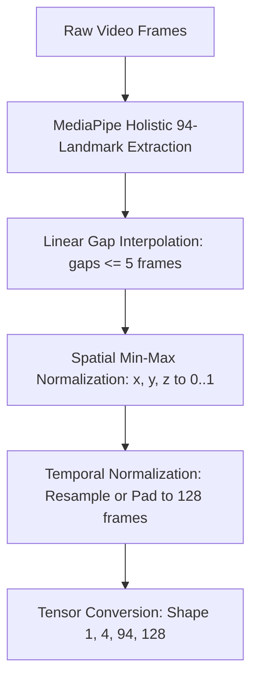
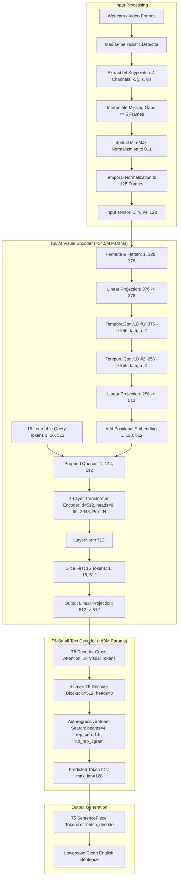

# ISLiM Model Architecture Technical Analysis

**Document:** `research/ISLiM/ARCHITECTURE_ANALYSIS.md`  
**Analysis Date:** 2026-11-09  
**Target Repository:** `research/ISLiM/` (Git commit: `ec50943b928c9db32b0a9bd30d74b7eb43d81a5d`)  
**Status:** Completed & Verified  
**Inspector:** Signova AI Engineering  

---

## 1. Architecture Overview

ISLiM (**I**ndian **S**ign **L**anguage **i**n **M**otion) is a compact, gloss-free, end-to-end Sign Language Translation (SLT) model with approximately **75 million parameters**. 

Instead of following traditional two-stage translation pipelines that first recognize discrete symbolic glosses (e.g., individual sign tokens) and then run a separate translation network, ISLiM translates continuous temporal keypoint sequences directly into natural English text.

The architecture comprises two main stages:
1. **Visual Encoder (~14.5M parameters):** A spatial-temporal feature extractor composed of a linear keypoint projection layer, two stacked temporal 1D convolutional layers, a 4-layer Transformer Encoder, and a set of 16 learnable query tokens that compress a 128-frame input sequence down to 16 latent representations ($8\times$ temporal compression).
2. **Text Decoder (~60M parameters):** A pretrained Hugging Face `t5-small` sequence-to-sequence model whose cross-attention layers condition directly on the 16 visual query tokens produced by the encoder to generate English text autoregressively.

```
Keypoint Sequence (B, 128, 94, 4)
             │
             ▼
   [Spatial-Temporal Projection & Conv1D]
             │
             ▼
   [Add Learnable Positional Embeddings]
             │
             ▼
   [Prepend 16 Learnable Query Tokens]
             │
             ▼
   [4-Layer Transformer Encoder (norm_first=True)]
             │
             ▼
   [Extract 16 Query Tokens: (B, 16, 512)]
             │
             ▼
   [T5-Small Decoder with Cross-Attention]
             │
             ▼
   Autoregressive English Text Output
```

---

## 2. Source Code Structure

The model code, data pipelines, and utility scripts in `research/ISLiM/` are structured as follows:

```text
research/ISLiM/
├── checkpoints/
│   ├── .gitkeep
│   ├── ISLiM_full_posestitch_pre_processed.pt  # 858.27 MB (Primary checkpoint, full iSign 4-loss)
│   └── ISLiM_4Loss_best_for_10kSpamoOF.pt      # 858.28 MB (SpaMo-OF 10k subset checkpoint)
├── configs/
│   ├── isign_4loss.yaml                        # Training hyperparameters for iSign 4-loss
│   ├── phoenix_crosslingual.yaml               # Transfer config for German Phoenix-2014-T
│   └── spamof_4loss.yaml                       # Training config for SpaMo-OF 10k subset
├── data/
│   └── splits/
│       ├── isign_train_pose_stitch.csv         # Train split metadata (113,800 samples)
│       ├── isign_val_pose_stitch.csv           # Validation split metadata (6,322 samples)
│       ├── isign_test_pose_stitch.csv          # Test split metadata (6,323 samples)
│       └── summary.json                        # Dataset split statistics
├── scripts/
│   ├── eval/
│   │   ├── evaluate_all.py                     # Evaluation harness (18 metrics, beam search)
│   │   ├── compare_phoenix.py                  # Benchmark vs Phoenix baseline
│   │   ├── compare_posestitch.py               # Benchmark vs PoseStitch baseline
│   │   ├── length_analysis.py                  # Impact of sequence length on BLEU
│   │   └── loss_ablation.py                    # Multi-loss ablation evaluator
│   ├── mobile/
│   │   ├── export_torchscript.py               # TorchScript / Lite interpreter exporter
│   │   ├── prepare_data.py                     # Mobile test data exporter
│   │   └── verify.py                           # 4-level parity validator (encoder, step, greedy, BLEU)
│   ├── preprocess/
│   │   └── extract_keypoints.py                # MediaPipe Holistic 94-landmark extractor
│   ├── viz/
│   │   ├── darken_for_print.py                 # Plot visualization formatting
│   │   └── keypoint_comparison.py              # Skeletal video comparison visualizer
│   ├── run.sh                                  # Training runner script
│   └── train.py                                # Main training script
├── src/
│   ├── data/
│   │   ├── augmentation.py                     # Spatial-temporal keypoint augmentations
│   │   ├── dataset.py                          # PoseStitchDataset & SpaMoOFDataset loaders
│   │   └── preprocessing.py                    # PoseStitch text cleaning & normalization
│   ├── islim/
│   │   ├── __init__.py                         # Package export
│   │   ├── encoder.py                          # TemporalConv1D, VisualEncoder, ISLiMEncoder
│   │   └── model.py                            # ISLiMModel wrapper
│   ├── losses/
│   │   ├── __init__.py
│   │   ├── contrastive.py                      # Bidirectional vision-text CLIP contrastive loss
│   │   ├── entropy.py                          # Logit entropy regularization
│   │   └── semantic.py                         # SentenceBERT semantic similarity loss
│   └── metrics.py                              # sacreBLEU, PS-BLEU, ROUGE-L, chrF++, METEOR
├── config.py                                   # Global environment & path resolution
├── requirements.txt                            # Upstream dependencies
└── README.md                                   # Project overview & documentation
```

---

## 3. Main Model Components

Every major neural component defined in the ISLiM codebase has been verified from source:

| Component Name | Source File | Class / Function | Purpose | Input Tensor | Output Tensor | Connected To |
|---|---|---|---|---|---|---|
| **Root Model Wrapper** | `src/islim/model.py` | `ISLiMModel(nn.Module)` | Coordinates visual encoder, T5 decoder, tokenizer, multi-loss training, and inference beam search. | `keypoints`: `(B, 4, 94, 128)` or `(B, 128, 94, 4)` | `loss` (train) or `List[str]` (generate) | Encapsulates `ISLiMEncoder` and `T5ForConditionalGeneration` |
| **Input Framing Wrapper** | `src/islim/encoder.py` | `ISLiMEncoder(nn.Module)` | Handles input permutation and resamples / zero-pads keypoint sequences to 128 frames. | `keypoints`: `(B, 4, 94, T)` or `(B, T, 94, 4)` | `(B, 16, 512)` | Delegates to `VisualEncoder` |
| **Visual Feature Extractor** | `src/islim/encoder.py` | `VisualEncoder(nn.Module)` | Projects keypoints, applies Conv1D, adds positional embeddings, prepends queries, runs Transformer encoder, and slices queries. | `keypoints`: `(B, 128, 94, 4)` | `(B, 16, 512)` | Feeds directly into T5 decoder |
| **Temporal Convolution Layer** | `src/islim/encoder.py` | `TemporalConv1D(nn.Module)` | Extracts local temporal motion patterns across adjacent frames ($k=5$). | `(B, C_{\text{in}}, 128)` | `(B, C_{\text{out}}, 128)` | Chained in `temporal_convs` (376 $\to$ 256 $\to$ 256) |
| **Query Token Bank** | `src/islim/encoder.py` | `self.query_tokens` (`nn.Parameter`) | 16 learnable latent vectors that aggregate global temporal information via cross-time self-attention. | `(1, 16, 512)` | Prepended to frame sequence: `(B, 144, 512)` | Input to Transformer Encoder |
| **Transformer Encoder** | `src/islim/encoder.py` | `nn.TransformerEncoder` | 4 Pre-LayerNorm Transformer encoder layers with GELU activations. | `(B, 144, 512)` | `(B, 144, 512)` | Query tokens extracted: `[:, :16, :]` |
| **Text Decoder** | `transformers` via `src/islim/model.py` | `T5ForConditionalGeneration` | Pretrained T5-small decoder cross-attending to 16 visual query tokens. | `inputs_embeds`: `(B, 16, 512)` | Logits `(B, L, 32100)` or token IDs | Feeds to tokenizer decoding |
| **Tokenizer** | `transformers` via `src/islim/model.py` | `T5Tokenizer` | SentencePiece tokenizer converting token IDs to English text strings. | Token IDs `(B, L)` | `List[str]` | Final text output |
| **CLIP Contrastive Loss** | `src/losses/contrastive.py` | `clip_contrastive_loss` | Aligns mean-pooled visual query embeddings with mean-pooled T5 token embeddings. | `(B, 16, 512)` visual & `(B, L)` text IDs | Scalar loss | Used during 4-loss training |
| **Semantic Loss** | `src/losses/semantic.py` | `SemanticLoss` | Enforces cosine similarity between T5 decoder hidden states and SentenceBERT embeddings (`all-MiniLM-L6-v2`). | `decoder_hidden`: `(B, L, 512)` | Scalar loss | Used during 4-loss training |
| **Logit Entropy Regularization** | `src/losses/entropy.py` | `entropy_regularization` | Penalizes overconfident, peaky vocabulary distributions to prevent mode collapse. | Logits: `(B, L, 32100)` | Scalar loss | Used during 4-loss training |

---

## 4. Input Data Requirements

The input to ISLiM is not raw video frames; it is a structured, normalized sequence of 3D skeletal and facial landmarks extracted using MediaPipe Holistic.

### 4.1 Landmark Breakdown (94 Keypoints)

The 94 keypoints selected by ISLiM from the full MediaPipe Holistic suite are:

```
[0-5] Body Pose (6 landmarks):
  0: Left Shoulder (MP #11)      1: Right Shoulder (MP #12)
  2: Left Elbow (MP #13)         3: Right Elbow (MP #14)
  4: Left Hip (MP #23)           5: Right Hip (MP #24)

[6-26] Left Hand (21 landmarks):
  6: Wrist (MP #0)               7-26: 20 Finger Joints (MP #1-#20)

[27-47] Right Hand (21 landmarks):
  27: Wrist (MP #0)              28-47: 20 Finger Joints (MP #1-#20)

[48-67] Lips (20 landmarks):
  Face mesh IDs: [61, 146, 91, 181, 84, 17, 314, 405, 321, 375, 
                  291, 409, 270, 95, 88, 178, 87, 14, 78, 308]

[68-83] Eyes (16 landmarks):
  Face mesh IDs: [33, 133, 160, 158, 153, 144, 145, 246, 
                  362, 263, 387, 385, 380, 373, 374, 249]

[84-93] Eyebrows (10 landmarks):
  Face mesh IDs: [107, 66, 105, 63, 70, 336, 296, 334, 293, 300]
```

Total landmarks = $6 + 21 + 21 + 20 + 16 + 10 = 94$.

### 4.2 Channel Layout (4 Values per Landmark)

Each landmark contains 4 floating-point features:
1. `x`: Normalized horizontal screen coordinate.
2. `y`: Normalized vertical screen coordinate.
3. `z`: Relative depth coordinate (MediaPipe estimated depth).
4. `visibility` (confidence indicator):
   - **Body pose:** Direct MediaPipe `lm.visibility` float value ($[0.0, 1.0]$).
   - **Hands:** Constant `1.0` when hand is detected; `0.0` when undetected.
   - **Face:** `1.0` if estimated $z > -0.5$, else `0.5`.

Total input feature dimension per frame = $94 \times 4 = 376$.

---

## 5. Preprocessing Pipeline

The preprocessing pipeline defined across `scripts/preprocess/extract_keypoints.py`, `src/data/dataset.py`, and `src/islim/encoder.py` consists of 5 deterministic stages:



### Stage 1: Landmark Extraction
- Extracted per frame using `mp.solutions.holistic.Holistic(model_complexity=1, smooth_landmarks=True)`.
- Keypoints with low tracking confidence default to `0.0`.

### Stage 2: Missing Landmark Interpolation
- Implemented in `interpolate_keypoints()` in `scripts/preprocess/extract_keypoints.py`.
- For any landmark missing for $\le 5$ consecutive frames (`visibility < 0.5`), linear interpolation across time is applied for $x, y, z$ and visibility.
- Gaps longer than 5 frames or completely absent landmarks remain `0.0`.

### Stage 3: Spatial Coordinate Normalization
- Implemented in `_normalize_keypoints()` in `src/data/dataset.py`.
- For each coordinate axis ($c \in \{x, y, z\}$), the values across all 94 keypoints and all frames are normalized independently to $[0, 1]$:
  $$\hat{c} = \frac{c - c_{\min}}{c_{\max} - c_{\min} + 10^{-8}}$$
- Channel 3 (`visibility`) remains unscaled.

### Stage 4: Temporal Normalization to 128 Frames
- Implemented in `_normalize_keypoints()` and `ISLiMEncoder._normalize_frames()`:
  - If sequence length $T > 128$: Uniformly downsampled across time using `torch.linspace(0, T - 1, 128).long()`.
  - If sequence length $T < 128$: Zero-padded along the temporal dimension at the end up to 128 frames.

### Stage 5: Tensor Formatting and Ordering
- Stored on disk as `.npy` with shape `(T, 94, 4)` as `float16` or `float32`.
- Formatted in PyTorch datasets as `(4, 94, 128)` (`(C, K, T)`).
- `ISLiMEncoder` accepts `(B, 4, 94, 128)` or `(B, 128, 94, 4)` and automatically permutes it to `(B, 128, 94, 4)` before flattening to `(B, 128, 376)`.

---

## 6. Encoder Architecture

The encoder (`VisualEncoder` and `ISLiMEncoder` in `src/islim/encoder.py`) operates as follows:

```
Input: Keypoints (B, 128, 94, 4)
  │
  ▼
Flatten to (B, 128, 376)
  │
  ▼
Linear Projection (keypoint_proj): 376 → 376
  │
  ▼
Transpose to (B, 376, 128)
  │
  ▼
TemporalConv1D #1: Conv1d(376, 256, k=5, p=2) → BatchNorm1d(256) → ReLU → Dropout(0.1)
  │
  ▼
TemporalConv1D #2: Conv1d(256, 256, k=5, p=2) → BatchNorm1d(256) → ReLU → Dropout(0.1)
  │
  ▼
Transpose back to (B, 128, 256)
  │
  ▼
Linear Projection (transformer_proj): 256 → 512
  │
  ▼
Add Positional Embedding: x + pos_embedding[:, :128, :]  (pos_embedding is Parameter(1, 1000, 512))
  │
  ▼
Prepend 16 Query Tokens: cat([query_tokens (B, 16, 512), x (B, 128, 512)], dim=1) → (B, 144, 512)
  │
  ▼
4-Layer Transformer Encoder:
    - d_model = 512
    - nhead = 8
    - dim_feedforward = 2048
    - activation = "gelu"
    - batch_first = True
    - norm_first = True (Pre-LayerNorm)
    - dropout = 0.1 (or 0.2 during training)
  │
  ▼
LayerNorm(512)
  │
  ▼
Slice Query Tokens: out = x[:, :16, :]  (Shape: B, 16, 512)
  │
  ▼
Linear Output Projection (output_proj): 512 → 512
  │
  ▼
Visual Encoder Output: (B, 16, 512)
```

### Key Architectural Insight: Token-Prepend Compression
The encoder uses a **query-token prepend mechanism**:
- Instead of using average pooling or an external cross-attention module to downsample time, 16 learnable query tokens are prepended to the 128 frame tokens ($16 + 128 = 144$ tokens total).
- Within the bidirectional 4-layer Transformer Encoder, self-attention allows the 16 query tokens to attend across all 128 temporal frame tokens simultaneously.
- After 4 layers of self-attention, only the first 16 tokens are sliced off.
- This compresses 128 frames into 16 rich temporal tokens ($8\times$ compression) while eliminating temporal convolution stride artifacts.

---

## 7. Decoder Architecture

The decoder is built upon Hugging Face's `T5ForConditionalGeneration` (`t5-small` configuration):

### 7.1 Architecture Specifications
- **Base Architecture:** Standard T5 sequence-to-sequence transformer decoder.
- **Hidden Dimension ($d_{\text{model}}$):** 512.
- **Decoder Layers:** 6 Transformer decoder blocks.
- **Attention Heads:** 8 heads ($d_{\text{kv}} = 64$).
- **Feed-Forward Dimension ($d_{\text{ff}}$):** 2048 with gated GELU activation.
- **Cross-Attention Conditioning:** The decoder cross-attention blocks attend directly to the visual encoder output passed via `inputs_embeds=encoder_output` of shape `(B, 16, 512)`.

### 7.2 Checkpoint Weights Packaging
- In the downloaded checkpoint (`ISLiM_full_posestitch_pre_processed.pt`), all T5 weights (`t5.decoder.*`, `t5.shared.*`, `t5.lm_head.*`, `t5.encoder.*`) are stored inside the checkpoint's `model_state_dict`.
- The decoder does not require a separate external checkpoint for model weights.
- **However**, the tokenizer configuration (`tokenizer_config.json`) and vocabulary SentencePiece file (`spiece.model`) are not serialized inside the `.pt` checkpoint file and are loaded at runtime via `T5Tokenizer.from_pretrained("t5-small")`.

---

## 8. Tokenizer and Text Generation

### 8.1 Tokenizer
- **Class:** `transformers.T5Tokenizer`.
- **Vocabulary Size:** 32,100 SentencePiece tokens.
- **Special Tokens:**
  - `pad_token_id`: `0` (`<pad>`)
  - `eos_token_id`: `1` (`</s>`)
  - `unk_token_id`: `2` (`<unk>`)
  - `decoder_start_token_id`: `0` (`<pad>`)
- **Maximum Generation Length:** 128 tokens.

### 8.2 Autoregressive Text Generation Configuration
As verified in `ISLiMModel.generate()` in `src/islim/model.py`:
- **Search Method:** Beam Search with `num_beams = 4`.
- **Repetition Penalty:** `repetition_penalty = 1.5` (prevents phrase stuttering common in keypoint translation).
- **N-gram Blocking:** `no_repeat_ngram_size = 3` (prevents repeated 3-word loops).
- **Length Penalty:** `length_penalty = 1.2` (encourages complete sentences).
- **Early Stopping:** `early_stopping = True`.
- **Sampling:** `do_sample = False` (deterministic generation).
- **Case Formatting:** Output text is converted to lowercase: `[t.lower() for t in decoded_strings]`.

---

## 9. Checkpoint Mapping

The downloaded checkpoints from Part 1.3 map to the model architecture as follows:

| Attribute | Primary iSign Checkpoint | SpaMo-OF 10K Checkpoint |
|---|---|---|
| **File Path** | `research/ISLiM/checkpoints/ISLiM_full_posestitch_pre_processed.pt` | `research/ISLiM/checkpoints/ISLiM_4Loss_best_for_10kSpamoOF.pt` |
| **File Size** | 899,966,348 bytes (858.27 MB) | 899,970,408 bytes (858.28 MB) |
| **Archive Format** | PyTorch Zip Archive (`PK\x03\x04`) | PyTorch Zip Archive (`PK\x03\x04`) |
| **Root Member** | `best_ps/data.pkl` | `best_model/data.pkl` |
| **Target Dataset** | Full iSign (PoseStitch splits, 113.8K train samples) | SpaMo-OF 10K subset |
| **Loss Function** | 4-Loss (CE + CLIP + Semantic + Entropy) | 4-Loss (CE + CLIP + Semantic + Entropy) |
| **Target Model Class** | `src.islim.model.ISLiMModel` | `src.islim.model.ISLiMModel` |
| **Loading Mechanism** | `model.load_state_dict(ckpt["model_state_dict"], strict=False)` | `model.load_state_dict(ckpt["model_state_dict"], strict=False)` |
| **Contained State** | `model_state_dict`, `optimizer_state_dict`, `epoch`, `best_bleu4`, `val_results` | `model_state_dict`, `optimizer_state_dict`, `epoch`, `best_bleu4`, `val_results` |
| **Recommendation for Signova AI** | **Primary Choice** (trained on full official iSign dataset with maximum vocabulary coverage) | Secondary baseline / comparative checkpoint |

---

## 10. Architecture Flow Diagram



---

## 11. Signova AI Integration Requirements

To integrate ISLiM cleanly into the Signova AI web application (React frontend + FastAPI backend):

### 11.1 Client-Server Responsibility Split

```
[React Frontend (Browser)]
  1. Capture webcam stream via getUserMedia.
  2. Run client-side MediaPipe Holistic (via `@mediapipe/tasks-vision`).
  3. Extract only the 94 specific landmark coordinates (x, y, z, visibility).
  4. Accumulate landmark frames into a client-side rolling temporal buffer.
  5. Transmit lightweight numeric arrays (shape [T, 94, 4], ~150 KB) over WebSocket / HTTP.
             │
             ▼ Network transmission (small JSON/Binary float array, NOT video)
[FastAPI Backend]
  6. Receive [T, 94, 4] landmark sequence.
  7. Validate shape, channel count (4), and keypoint count (94).
  8. Run linear gap interpolation (<= 5 frames).
  9. Run spatial min-max normalization to [0, 1].
  10. Run temporal normalization (resample / zero-pad to 128 frames).
  11. Construct PyTorch tensor (1, 4, 94, 128) on GPU/CPU.
  12. Execute `ISLiMModel.generate(..., num_beams=4)`.
  13. Return translated English text string and inference timing to frontend.
```

### 11.2 Real-Time Camera Considerations
- **Sequence vs. Single Frame:** ISLiM is a sequence translation model, not an isolated sign classifier. It cannot translate an individual snapshot frame.
- **Signing Phrase Segmentation:** The user must perform a sign sentence or phrase (typically lasting 2 to 6 seconds, corresponding to ~60–180 frames at 30 FPS).
- **Trigger Mechanisms:**
  - *Option A (Push-to-Sign Button):* User clicks "Start Signing", performs the sign phrase, clicks "Translate". Frontend sends the buffered frames.
  - *Option B (Motion Velocity VAD - Sign Activity Detection):* Frontend tracks hand landmark movement velocity; when hands rest at the bottom/hips for >0.8 seconds after activity, the completed gesture buffer is automatically submitted for translation.

### 11.3 Wrappers and Service Architecture
Without modifying original ISLiM source files, Signova AI backend should provide:
1. `backend/app/ml/preprocessing.py`: Standalone landmark extraction, interpolation, and spatial-temporal normalizer.
2. `backend/app/ml/model_loader.py`: Safe checkpoint loader assembling `ISLiMModel` with pre-cached tokenizer assets.
3. `backend/app/ml/inference.py`: Inference service running `model.generate()` with configurable beam search and error handling.
4. `backend/app/api/routes/recognition.py`: FastAPI endpoint accepting landmark arrays and returning translated text.

---

## 12. Hardware and Compatibility Risks

### 12.1 Hardware Footprint Assessment
- **Parameter Count:** 75M parameters.
- **Model Storage:**
  - Downloaded checkpoint: ~858 MB (due to bundled optimizer AdamW momentum/variance states).
  - Model weights alone (inference-only): ~300 MB in FP32, ~150 MB in FP16.
- **VRAM Requirements:**
  - NVIDIA GeForce RTX 2050 (4 GB VRAM) is anticipated to be sufficient for batch size 1 inference, which typically uses < 1.5 GB VRAM. However, actual memory allocation during beam search ($4\times$ parallel beams with KV cache) must be measured during testing.
- **CPU Fallback:**
  - On CPU, inference latency will be noticeably higher due to the 6 T5 decoder layers running beam search (estimated 800–1800 ms per sentence on CPU vs 50–150 ms on GPU).

### 12.2 Software Dependencies and Versions
- Python 3.11 compatibility: Confirmed compatible with standard PyTorch 2.x and Transformers 4.x.
- `sentencepiece` requirement: T5Tokenizer requires the `sentencepiece` library installed.
- Hugging Face cache availability: System requires either network access or pre-cached `t5-small` tokenizer files (`spiece.model`, `tokenizer_config.json`, `config.json`).

---

## 13. Confirmed Findings

1. **Pretrained Checkpoints:** Both downloaded checkpoints (`ISLiM_full_posestitch_pre_processed.pt` and `ISLiM_4Loss_best_for_10kSpamoOF.pt`) are uncorrupted PyTorch zip archives containing valid state dictionaries for the full 75M-parameter architecture.
2. **Landmark Count:** The model strictly requires **94 landmarks** with 4 coordinates each ($94 \times 4 = 376$ input channels). It cannot accept 21-hand-only landmarks or raw 468-point face meshes without the specific indexing defined in `extract_keypoints.py`.
3. **Temporal Length:** The model enforces a sequence length of **128 frames**. Shorter sequences are zero-padded; longer sequences are uniformly downsampled.
4. **Temporal Compression:** 16 learnable query tokens compress the 128 frames down to 16 tokens ($8\times$ compression) before passing to the T5 decoder.
5. **Decoded Language:** The output is continuous English text generated autoregressively by T5-small, lowercase with punctuation normalized.
6. **Task Category:** ISLiM is a **continuous/phrase-level gloss-free sign language translation model**, not an isolated static alphabet or isolated word classifier.

---

## 14. Pending Verification Items

The following items cannot be confirmed by static code inspection alone and must be verified experimentally in Part 1.5 (Safe Model Loading) and Part 1.6 (Verification):

1. **`torch.load` Safe Loading Behavior:** The checkpoints were saved with full training dictionaries containing `optimizer_state_dict`. In PyTorch 2.4+, `torch.load(..., weights_only=True)` may reject certain dictionary structures unless configured properly.
2. **`t5-small` Local Cache Status:** On this development workstation (`C:\Users\Lenovo\.cache\huggingface\hub`), no cached `t5-small` files were found. When `ISLiMModel` instantiates `T5Tokenizer.from_pretrained("t5-small")` and `T5ForConditionalGeneration.from_pretrained("t5-small")`, network access or manual caching will be needed.
3. **Measured VRAM and Latency:** Exact inference latency (greedy vs beam search) and VRAM consumption on the NVIDIA RTX 2050 GPU must be measured with a dummy or sample input tensor.
4. **MediaPipe Web vs Python Coordinate Parity:** Parity between Python MediaPipe Holistic and browser-based MediaPipe (TensorFlow.js / MediaPipe Web Tasks) landmark ranges ($x, y, z$) must be checked during frontend prototyping.

---

## 15. Conclusion

The technical analysis of the official ISLiM repository demonstrates a coherent, well-structured, and computationally compact architecture for Indian Sign Language translation. 

By combining a 14.5M parameter convolutional-transformer encoder with a 16-query temporal bottleneck and a fine-tuned 60M parameter T5-small decoder, ISLiM achieves continuous keypoint-to-English translation within an exceptionally light 75M parameter budget. 

Its keypoint-based input representation makes it ideal for web-based Signova AI deployment, as landmark extraction can run on client hardware (browsers) while the backend performs fast sequence translation with minimal network bandwidth overhead.

Part 1.4 architecture analysis is complete. Ready for Part 1.5 (Safe Model Loading) upon review and approval.

